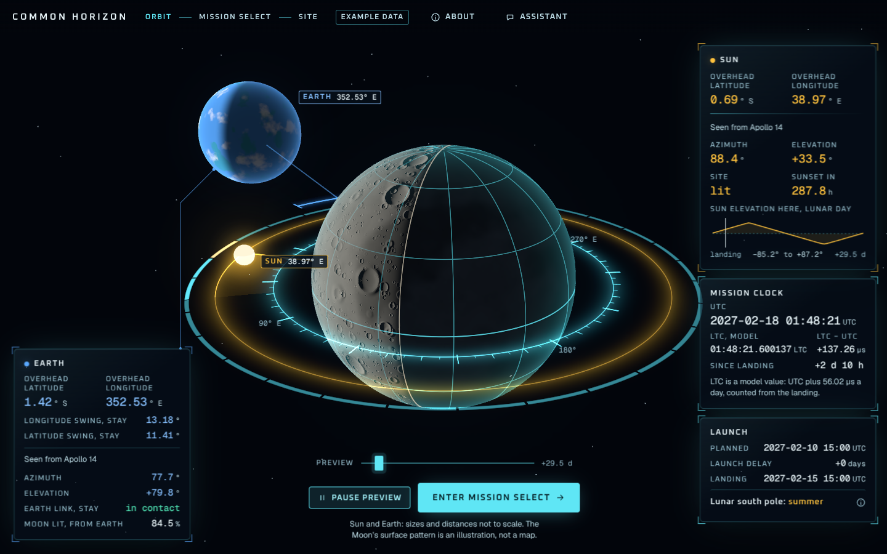
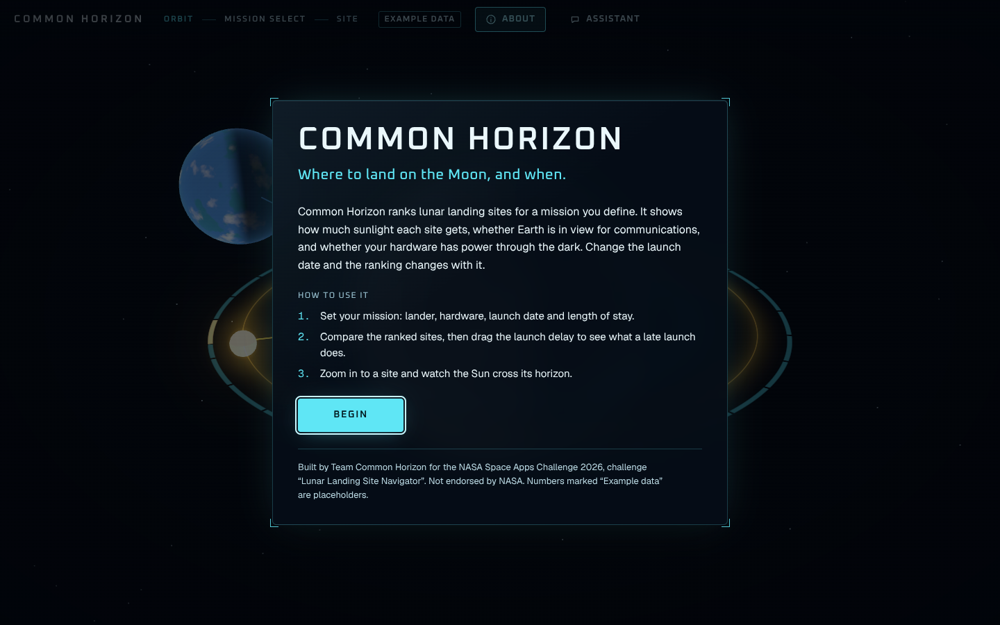
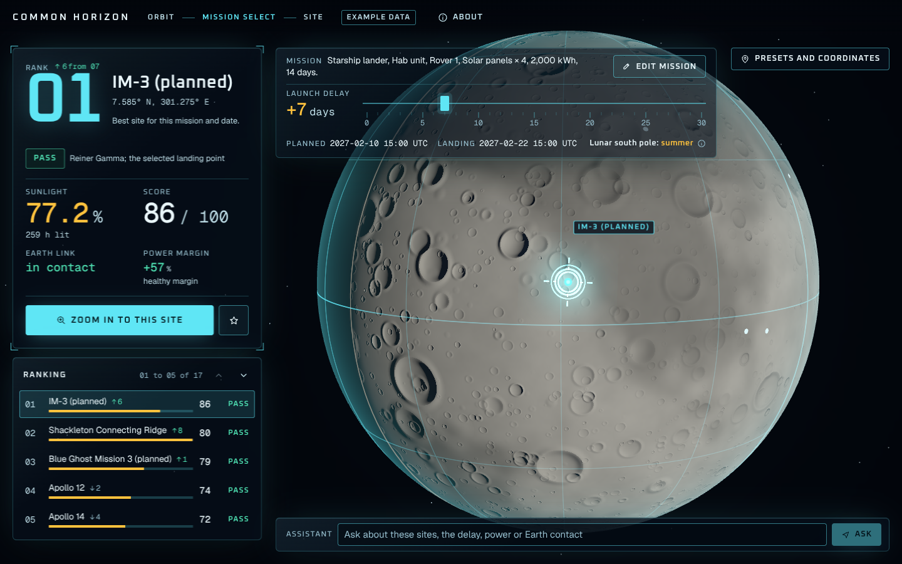
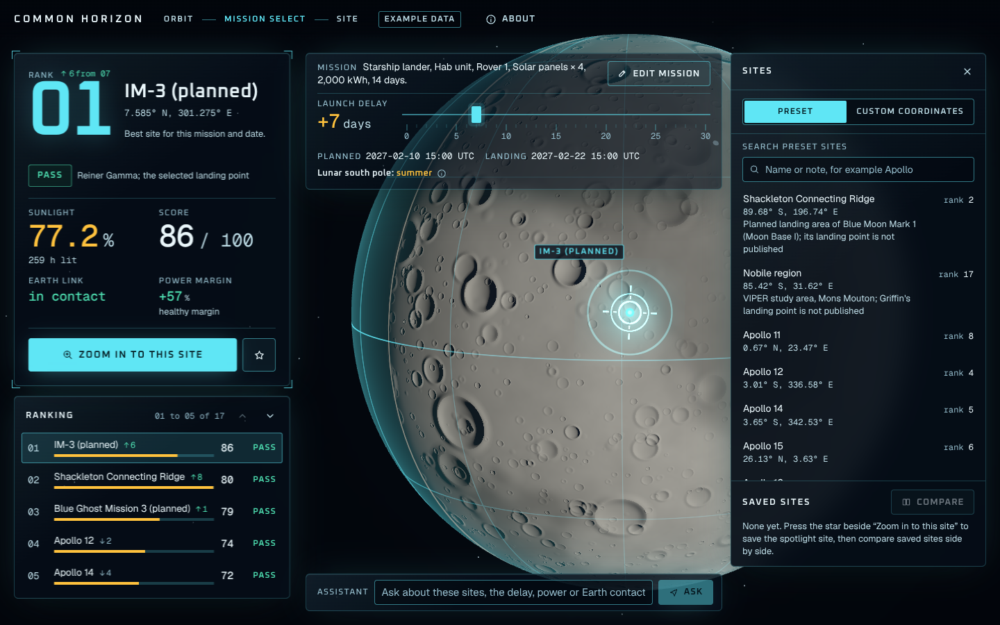
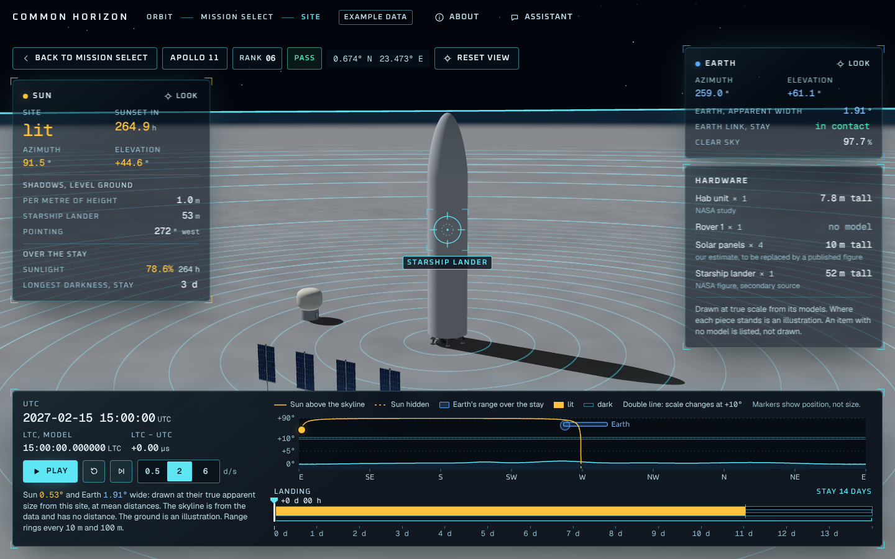
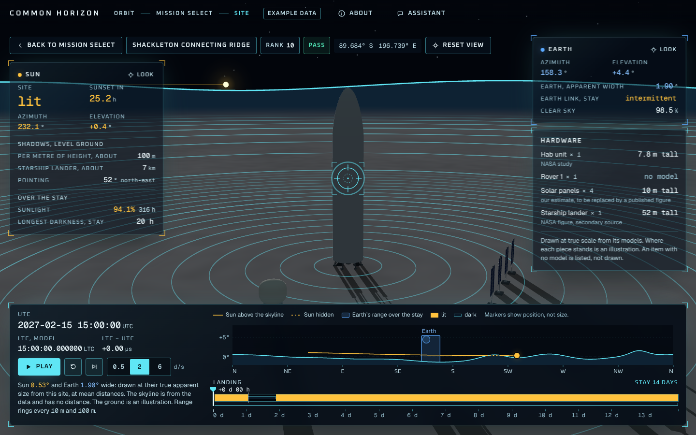
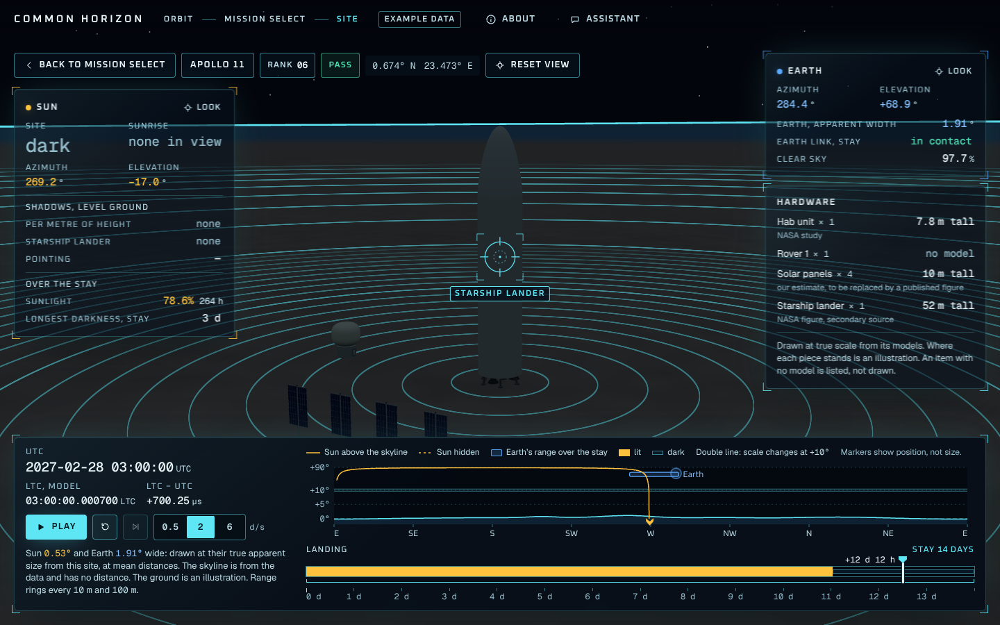

# Lunar Landing Site Navigator — website (`web/`)

Team Common Horizon, NASA Space Apps 2026, challenge "Lunar Landing Site Navigator".

The website helps a mission planner pick a lunar landing site and date: choose hardware, see sites
ranked for sunlight, Earth contact and power, and see how a launch delay ("slip") changes the
ranking. Every number comes from the Python backend in `backend/`. Until the backend is connected,
the website runs on **example answers** (mock mode) so it can be shown and tested on its own.

## Pictures

The interface is one continuous 3D space in three stages. These pictures are taken from the running
app on example data (`npm run screens`), at 1440 x 900.

**Stage 1, Orbit.** The Moon with the Sun and Earth riding their rings, and the readouts running.



The landing card that opens over it on first load:



**Stage 2, Mission select.** One site in the spotlight, the ranked strip under it and the
launch-delay scrubber, here with a delay of one week: the ranking has reordered.



The site drawer, slid in from its handle and open on the preset list:



**Stage 3, Site.** Down at the site: the mission's hardware at true scale on level ground, the
terrain skyline from the data along the horizon, and the instrument around it. Here the Sun is about
45 degrees up, so the lander's shadow is about as long as the lander is tall.



A site at the lunar south pole at its landing: the Sun grazes the terrain skyline and shadows run
for kilometres.



After sunset the terrain hides the Sun: only a dim fill is left, the stage says "dark", and the
skyline, the range rings and the reticle stay lit.



## Run it on your computer

You need Node.js 22 or newer (it includes `npm`). Then, in a terminal:

```bash
cd web
```

```bash
npm install
```

```bash
npm run dev
```

The terminal prints an address such as `http://localhost:5173/`. Open it in a browser.
Press `Ctrl+C` in the terminal to stop the server.

## Scripts

| Command | What it does |
| --- | --- |
| `npm run dev` | Starts a development server that reloads when you save a file. |
| `npm run build` | Builds the static website into `web/dist/` (plain HTML, CSS and JS; no server needed). |
| `npm run preview` | Serves the built `dist/` folder at `http://localhost:4173/` to check the build. |
| `npm run typecheck` | Checks the TypeScript types without building. |
| `npm test` | Runs the unit tests (Vitest). |
| `npm run test:e2e` | Builds, serves and runs the browser tests (Playwright) at a desktop and a phone width. |
| `npm run screens` | Takes the pictures in `docs/screens/` from the running app, at 1440 x 900 and 390 x 844. |

Before the first `npm run test:e2e` on a new computer, install the test browser once:

```bash
npx playwright install chromium
```

## Mock mode and the backend

`src/api/client.ts` is the only file that talks to the network.

* **`VITE_API_BASE` unset or empty → mock mode.** Answers come from `src/api/examples/*.json`
  and a small mock model in `src/api/mock/`. The top bar shows an "Example data" badge.
* **`VITE_API_BASE` set → live mode.** Copy `.env.example` to `.env.local` and set the address:

  ```bash
  cp .env.example .env.local
  ```

  then edit `.env.local`, for example `VITE_API_BASE=http://localhost:8000`, and restart `npm run dev`.

  The backend must allow cross-origin requests (CORS) from the address the website is served
  from, unless both are served from the same address.

The mock answers change with the slip (the Sun's position over each site moves through the lunar
day), so the ranking visibly reorders. They are **not** real data: the geometry is simplified and the
terrain is invented. See `src/api/examples/mock-model.json`.

To see the other states on purpose in mock mode, add one of these to the page address:

| Address ending | Shows |
| --- | --- |
| `?mock=slow` | the waiting state (every answer takes 2.5 s) |
| `?mock=empty` | the empty state (answers with nothing in them) |
| `?mock=error` | the error state (every call fails, with a "Try again" button) |
| `?assistant=off` | the assistant's fifth state: unavailable |
| `?webgl=off` | the flat 2D Moon used when a browser has no 3D (WebGL) |

### API calls (provisional)

The types in `src/api/types.ts` are hand-written and marked **provisional**: they will be
regenerated from the backend's OpenAPI file. Sample answers the website expects are in
`src/api/examples/*.sample.json` (kept in step with the mock by a test).

| Call | Method and path | Purpose |
| --- | --- | --- |
| health | `GET /health` | Is the backend up; is the assistant available? |
| site list | `GET /sites` | Preset sites (latitude, east longitude 0–360). |
| catalog | `GET /catalog` | Hardware rows for the planner. |
| evaluate | `POST /evaluate` | Score each site for a launch time (UTC), slip (0–30 days), stay (days), hardware and battery storage (kWh). |
| horizon | `POST /horizon` | Skyline, the Sun's path (above / hidden) and Earth's box for one site and time window. |
| fit and power check | `POST /check` | Does the hardware fit; day and night power checks, with battery storage (kWh). |
| ask the assistant | `POST /assistant` | Text answer only. The assistant never controls the interface. |

Every call shows four states in the interface — waiting, answer, empty, error — and the assistant
has a fifth: unavailable (the backend answers HTTP 503, or `/health` says so).

### Battery storage and the power checks (for the backend)

The planner has a **Battery storage** row: a number typed in kWh (empty or 0 means none). It is not a
catalog row. The website sends it as **`storage_kwh`** (a number, 0 = none) in three requests:
`POST /evaluate`, `POST /check` and the `context` of `POST /assistant`.

The power numbers follow the planner module's `power_check` (see `planner/README.md`). The backend
can pass these straight through:

| Website field (`src/api/types.ts`) | Planner module |
| --- | --- |
| request `storage_kwh` | `power_check(storage_kwh=...)` |
| `night.longest_darkness_h` | `longest_darkness_h`: the longest unbroken darkness inside the stay, from the physics engine. `null` when no site is picked. |
| `day.refill_hours` | `refill_hours` (default: one lunar month, 708.73 h, minus the longest darkness) |
| `day`: `generation_kw`, `load_kw`, `refill_kw`, `refill_kwh`, `margin_percent`, `status`, `passes` | `day`: `available`, `load_kw`, `refill_kw`, `refill_kwh`, `margin_percent`, `status`, `passes` |
| `night`: `generation_kw`, `load_kw`, `per_night_kwh`, `storage_kwh`, `storage_needed_kwh`, `available_kwh`, `load_kwh`, `margin_percent`, `status`, `passes` | `night`: `sources_kw`, `load_kw`, `per_night_kwh`, `storage_kwh`, `storage_needed_kwh`, `available_kwh`, `load_kwh`, `margin_percent`, `status`, `passes` |
| `night.basis`: `energy`, `power`, `power only`, `no darkness` | `night.basis`: "energy over the longest darkness", "power: sources in darkness carry the night", "power (no darkness duration given)", "no darkness" |
| `balance`: `margin_percent`, `status`, `limiting` | `balance`: the same three keys |
| `power_notes` | `notes` |
| evaluate: `power_margin_percent`, `power_status` | that site's `balance.margin_percent` and `balance.status` |

* `status` is `green`, `yellow`, `red` or `none`. A margin can be `null` while the status is `red`
  (a load with nothing at all to power it); the website then shows "no supply".
* With no site picked there is no darkness length, so, as in the planner module, the night check
  compares power only and storage is not counted. The planner says so in words.
* `day.needed` and `night.needed` have no planner key: they are `status != "none"`.
* `storage_needed_kwh` is shown rounded **up** to a whole kWh ("about N kWh"), so send it unrounded
  or rounded up, never down.
* When storage must be refilled but no sunlit hours are left (longest darkness of a lunar month or
  more), the planner raises `PlannerInputError`; the mock shows a red day check instead. The backend
  should pass `refill_hours` from the physics engine, or turn that error into a red day check.
* The mock copies the planner's arithmetic in `src/api/mock/power.ts` (tests in
  `src/api/mock/power.test.ts` use the planner README's figures). The mock catalog's
  optional `energy_per_night_kwh` stands for per-night items such as rover keep-warm.

## How the screen is organised

One 3D space fills the window, and a head-up display (HUD) of translucent glass panels floats over
it. The camera flies between three stages; nothing reloads. A bar across the top names the app,
shows which stage you are in, carries the "Example data" badge while the app runs on example
answers, and has **About**, which reopens the landing card.

**Landing card.** On first load a glass card sits over stage 1 and says what the app is, what it is
for and how to use it. **Begin**, Escape or a press outside closes it. It does not come back during
the same visit (one browser tab); **About** opens it again. While it is open, Tab stays inside it.

**Stage 1, Orbit.** The Moon, large and centred, inside a ring system that lies in the Moon's
equatorial plane and is seen at an angle. From the inside out:

* a **longitude scale** with a tick every 5 degrees (0, 90 E, 180 and 270 E are numbered);
* the **Sun ring**: the Sun rides it at the longitude where the Sun is overhead on the Moon (that
  point really does circle the Moon once each lunar day). The brighter arc is what the Sun has swept
  since the landing, with an afterglow behind the Sun's line;
* a **ring of days**: one segment for each day of the lunar day (29.53 days), lit for each day since
  the landing;
* **Earth's bracket**: not a ring, because Earth does not circle the Moon's sky. A short arc with
  end caps spans the range that the longitude of Earth's overhead point really moves through over
  the stay (its "swing", from the data layer), with a mark at where it is now.

**Earth** itself is drawn as a distant, larger body out along its true direction from the Moon,
joined to its bracket by a line. It is placed farther from the Moon than the camera ever goes in
mission select and is only drawn while it is behind the Moon's centre as the camera sees it, so it
can never come between the camera and the Moon or cover a site marker. Sizes and distances are
**not to scale** (really Earth is about 221 Moon radii away and 3.67 times the Moon's diameter), and
a line on screen says so.

The camera looks from the side of the Moon away from Earth, so Earth stands behind the Moon and off
to one side. Which side is chosen so that the camera sees as much of the Moon's sunlit half as it
can at the landing; the panels arrange themselves around it. The camera sways a few degrees and
leans a little with the pointer. The panels are laid out so the Sun on its ring, Earth and their
tags never pass behind a glass panel (`src/scene/orbitView.test.ts` checks the arithmetic, and a
browser test checks the real screen through a whole lunar day).

The Sun lights the Moon from its own side, and the day-night line and both overhead points are
marked on the surface. The Sun and Earth each carry a small tag with their longitude. A tag hides
while its body is behind the Moon.

Time previews forward on its own, 6 hours each second, from the landing through one lunar day, then
starts again. **Pause preview** stops it and the **Preview** scrubber moves it by hand. The preview
never changes the launch date. Four panels read out, once per frame:

* **Sun**: latitude and longitude of the point where the Sun is overhead; from the selected site,
  the Sun's azimuth and elevation, whether the site is lit, the hours to the next sunrise or sunset,
  and a small graph of the Sun's elevation there over the lunar day;
* **Earth**: the same overhead point for Earth, how far it swings in longitude and latitude over
  the stay, Earth's azimuth and elevation from the selected site, the site's Earth link over the
  stay, and the share of the Moon's disc that is lit as seen from Earth;
* **Mission clock**: UTC, LTC (model value), the LTC offset in microseconds and the time since landing;
* **Launch**: planned launch, launch delay, landing, and the season at the lunar south pole on the
  landing date ("summer" while the Sun's overhead point is south of the lunar equator). Hover or tap
  it for a one-line explanation.

"The selected site" is the site you picked, or else the best-ranked site, or else the first preset.
The one action here is **Enter mission select**. The Moon's surface pattern is a generated
illustration, not a map; a line on screen says so.

**Stage 2, Mission select.** The camera turns the Moon to one site and marks it with a reticle and a
name tag. That site is the **spotlight**: the panel at the left gives its rank as a large numeral,
its name, sunlight, score, Earth link, power margin, pass or fail with the reason, and **Zoom in to
this site**. Under it a short **ranking** strip shows the rows around it: click one or use the arrow
keys to move the spotlight; **Follow the best site** hands it back. Across the top, the mission in
one line opens the **mission planner**, and the **launch delay** scrubber moves the landing: the
ranking reorders and each row says how far its site moved; the planned launch never changes.
Presets, coordinates and saved sites are in a glass **drawer** at the right, so a long list never
buries the one site that matters; the **Mission Assistant** runs along the bottom. The picture
shifts to keep the site's marker and tag clear of the open panels (`src/scene/missionView.ts`).

**Stage 3, Site.** **Zoom in to this site** flies the camera down to the site, inside the same
canvas, and time runs through the stay.

*The way down.* The camera dives at the site on the Moon. Over the last moments of the dive a veil
closes over the picture, the camera is placed in the site's own world (measured in metres, with the
landing point at its origin) and the veil lifts on a descent: from high over the landing point
looking straight down, the ground turning underneath, then tipping up until the horizon rises and
the camera rests beside the lander. One reticle stays on the landing point all the way, from the
Moon's surface to the lander, so the eye keeps its target across the change of worlds. **Back to
mission select** returns the same way and the spotlight is unchanged. A second press during a flight
does nothing, and a flight that nothing finishes ends by itself after 4.5 seconds. A press or a
wheel turn during the descent hands the view over at once.

*The picture: what is data, and what is an illustration.*

* **The sky** rides on a dome centred on the camera, because the data gives directions and no
  distances. The **Sun** and **Earth** stand where the readouts say (one function, `skyAt` in
  `src/util/quantities.ts`, serves the readouts, the plot, the timeline and the scene, so they
  cannot disagree). Each is a ball of exactly the size that makes it as wide as it looks from the
  site, at mean distances: about 0.53° for the Sun and 1.90° to 1.91° for Earth
  (`src/util/bodies.ts`, sources in `SOURCES-web.md`), true at any zoom, and a line on screen says
  so. The soft glow round the Sun is faint and is not the disc. Earth's lit side faces the Sun. A
  thin line across the sky is the Sun's path over the stay, through the same samples as the plot.
* **The skyline** is the horizon answer's own, at every compass direction: a band from below level
  up to the skyline, with the skyline drawn as a bright line. It is the only thing in the sky that
  hides anything, so the Sun goes behind it exactly when the data says the terrain hides the Sun
  (`src/scene/siteView.test.ts` checks this for every preset site through a stay). It has no
  distance, and the screen says so.
* **The light** follows the answer's word. Lit: sunlight from the Sun's direction. Dark: the
  terrain hides the Sun, only a dim fill is left and the stage says "dark". Close to a sunrise or
  sunset the disc can sit a hair above or below the skyline while the word has already changed (or
  not yet): the answer's samples are up to an hour apart.
* **The ground** is a level plane and an illustration (the data has no terrain near the site); the
  screen says so. It is never drawn above a cut-off below the lowest point of the skyline, so it
  cannot cover sky the data says is open. Its brightness follows the Sun's height by a display
  curve, not lunar photometry. **Range rings** mark every 10 m out to 200 m and every 100 m out to
  2 km.
* **The hardware** is the mission's, in the mission's counts, drawn from the models in
  `public/models/` at **true scale**: one model unit is one metre and nothing is ever scaled
  (`src/scene/models.test.ts` pins each shape to its published size, and a shape that does not
  match is not drawn). Where each piece stands is an illustration, laid out so nothing overlaps
  (`src/scene/siteLayout.ts`). The shapes are loaded on demand with three.js's own `GLTFLoader`;
  while one is loading, or if its file fails, its row in the hardware list says so and the rest of
  the scene carries on. The rover has no model: it is listed, never drawn.
* **Shadows** are flat projections on the level ground: each model is flattened onto the ground
  along the sunlight, so a shadow is height ÷ tan(Sun's elevation) long and points away from the
  Sun, the same figures as the shadow readouts. They are drawn while the site is lit and the Sun's
  whole disc is above level. Hardware casts shadows on the ground only, not on other hardware.

Drag to turn the view; the wheel or a pinch zooms; close to a tall lander the view can be tipped up
to the sky. **Look** on the Sun panel or the Earth panel turns the view to that body, wherever it
stands (for a body high in the sky the camera comes down to the ground and looks up), and **Reset
view** returns to the view beside the lander. The reticle on the lander carries its name. The Sun
and Earth carry tags with their elevation, joined to their panels by leader lines, while they are in
the clear part of the picture and no hardware stands in front of them.

*The instrument.* A strip across the top names the site (rank, pass or fail, coordinates) and holds
**Back to mission select**. Two wings read the sky at the instant shown: the **Sun** (lit or dark,
the time to the next sunrise or sunset, azimuth and elevation, the shadow of a metre of height and
of the lander on level ground, and its light over the stay) and **Earth** (azimuth, elevation,
apparent width and the Earth link over the stay), with the mission's **hardware** and the height of
each model. A console along the bottom holds the **mission clock** (UTC and the LTC model value),
**Play**, **Back to the landing**, a **jump** to the next sunrise or sunset and three **speeds**,
and the **horizon plot** directly above the **stay timeline**:

* the horizon plot is the sky unrolled (compass direction across, height above level upward) with
  the terrain skyline, the Sun's path (solid above the skyline, dashed where the terrain hides it),
  the part of the sky Earth moves through, and a Sun dot and an Earth ring that follow the clock;
* the stay timeline shows lit periods as solid blocks and dark periods as low outlines, and it is
  the scrubber: drag anywhere on it, or use the keyboard (arrows step an hour, six with Shift; Page
  Up and Page Down a day; Home and End the ends; Space plays and pauses). With a launch delay it
  starts at the planned landing: the stretch before the landing is hatched and labelled with the
  delay, a dashed marker stands at the planned landing and a bracket spans the stay. Scrubbed into
  that stretch, the stage says "before landing" and how long until it, and the scene shows the site
  without hardware. Play always runs the stay itself, from the landing to its end, and stops there.

On a phone the same parts are a status card, a dock along the bottom and a sheet that rises above
it; without WebGL the horizon plot takes the scene's place and every readout still runs.

**Where the numbers come from.** Every readout shows a quantity from the API layer (in mock mode,
the mock model): nothing on screen is random or made up, and a readout shows a dash until its data
arrives. To follow the Sun and Earth through time, the website asks `POST /evaluate` once for each
day of the window (one probe point, no hardware, launch moved a day at a time), reads the
`geometry` of each answer and joins them with a smooth curve (`src/state/geometry.ts`,
`src/util/track.ts`). Answers are cached, so changing the delay by a day asks for one new day. A
real backend is asked six questions at a time. Earth's direction at a site is worked out from
Earth's overhead point, which ignores parallax and is good to about 1 degree.

**Lit and dark.** Whether a site is lit, and when the Sun next rises or sets behind the terrain,
come from the site's horizon answer (`POST /horizon`): the terrain skyline around the site and the
Sun's path through the window, each sample marked above or hidden. The website asks for samples
never more than one hour apart, however long the stay: a window longer than 150 days is asked for
in several requests that meet end to end and are joined into one answer (`src/state/horizonLoad.ts`).
A change is placed where the Sun, followed along a straight line between two samples, crosses the
skyline as the answer gives it (`src/util/horizon.ts`); against the mock model that is within a
tenth of an hour or so, which is how finely the time to the next change is shown.

**Time.** LTC (model value) = UTC + 56.02 microseconds for every day counted from the landing time.
The rate is a published estimate (Ashby and Patla, 2024; see `SOURCES-web.md`). Counting from the
landing is this app's own convention, and the lunar time standard is still being defined, so the
clock is labelled as a model value.

**Power colours.** Margin percent = (available − load) / available × 100, as in the planner module.
Margin of 25 % or more: green. From 0 % up to 25 %: yellow (exactly 0 % counts as yellow). Below 0 %:
red. The words next to the number repeat the meaning and name the limiting check.

**Reduced motion.** Visitors whose system asks for reduced motion get no camera sway or lean, no
flights (stages switch at once; down to the site and back is a cut with a short fade), a preview
that starts paused, a site clock that never starts by itself, and a ranking that reorders at once
instead of sliding.

**Type and colour.** Three type families, served from this site: Oxanium (titles and labels), Geist
Mono (readouts) and Geist (chat and longer text). Every colour is a CSS variable in
`src/styles/theme.css`. No text is smaller than 12 px, and text colours are checked to keep a
contrast of at least 4.5 to 1 on the glass panels (`src/styles/contrast.test.ts`).

## Folder map

```
web/
  index.html               page shell
  src/main.tsx             start-up
  src/App.tsx              the 3D space, the HUD over it and the landing card
  src/api/                 client.ts (network), types.ts (provisional), mock/, examples/
  src/state/               app state, data loading, the geometry track loader, the four-state hook,
                           assistant.ts (the assistant's conversation), horizonLoad.ts (a site's
                           horizon answer for a window of any length), models.ts (the hardware
                           models' sizes)
  src/stages/              the HUD of each stage, the top bar, the landing card, the clocks
    MissionHud.tsx         mission select: where its panels sit, and what they leave of the window
    Spotlight.tsx          the spotlight site: rank, name, readouts, pass or fail, zoom in
    RankStrip.tsx          the short ranked strip under the spotlight
    MissionBar.tsx         the mission in one line, the launch-delay scrubber, the dates
    SeasonLine.tsx         "Lunar south pole: summer" with its note
    SiteDrawer.tsx         the drawer: presets, coordinates, saved sites
    MissionSheet.tsx       the mission planner sheet
    Assistant.tsx          the Mission Assistant (along the bottom, or as a sheet)
    SiteHud.tsx            the site stage: where its panels sit, and what they leave of the window
    SitePanels.tsx         its reading panels: Sun, mission clock, Earth, hardware
    SiteVeil.tsx           the veil over the picture while the camera changes worlds
    LanderReticle.tsx      the reticle that rides the landing point from the Moon down to the lander
    Playback.tsx           the clocks: the Orbit preview, and Play through the stay
  src/hud/                 reusable HUD pieces: glass panel, readout, ring dial, reticle, line graph,
                           drawer, sheet, leader lines, parallax; HorizonPanel.tsx (the horizon plot),
                           StayTimeline.tsx (lit and dark periods, and the scrubber), Transport.tsx
                           (play, pause, speed)
  src/scene/               the 3D space: Moon world, ring system, camera director, 2D fallback;
                           orbitView.ts and missionView.ts (where things sit on screen, as arithmetic)
    SiteWorld.tsx          the site's world: lights, anchors, and the parts below
    SiteSky.tsx            the sky dome: stars, Earth, the Sun and its path, the terrain skyline
    SiteGround.tsx         the level ground with its range rings (siteShaders.ts)
    SiteHardware.tsx       the hardware models and their shadows (siteModels.ts loads the shapes)
    SiteRig.tsx            the camera at the site: the descent, the rest pose, turn and zoom
    siteView.ts            the site's picture as arithmetic: dome, disc sizes, ground cut, camera poses
    siteLayout.ts          where the hardware stands
    siteNow.ts             the sky at the instant shown, shared by every part of the scene
  src/components/          icons, ComparePanel.tsx (saved sites side by side) and shared parts
  src/util/                time (LTC), geometry, the Sun and Earth track, horizon reading, readout
                           quantities, season, power colours, ranking, mission.ts (the one-line
                           mission summary), storage.ts (battery entry), bodies.ts (sizes and
                           distances of the Sun, Earth and the Moon), shadow.ts (shadows on level
                           ground), stay.ts (play and scrub through the stay), horizonPlot.ts (the
                           horizon plot's scales and shapes)
  src/styles/              theme.css (every colour), fonts.css, index.css
  src/assets/fonts/        the three font families and their licences
  e2e/path.spec.ts         the browser tests: landing card, Orbit, mission select
  e2e/site.spec.ts         the browser tests: the site stage
  e2e/screens.capture.ts   takes the pictures in docs/screens/
  docs/screens/            pictures of the app
  public/textures/         slot for the Moon colour map (see its README)
```

`public/models/` belongs to another part of the team; this folder does not touch it.

## Sources

Libraries, data, figures and licences are listed in [`SOURCES-web.md`](./SOURCES-web.md).
